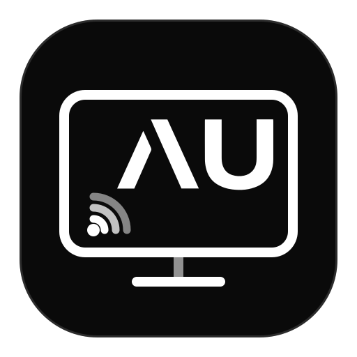
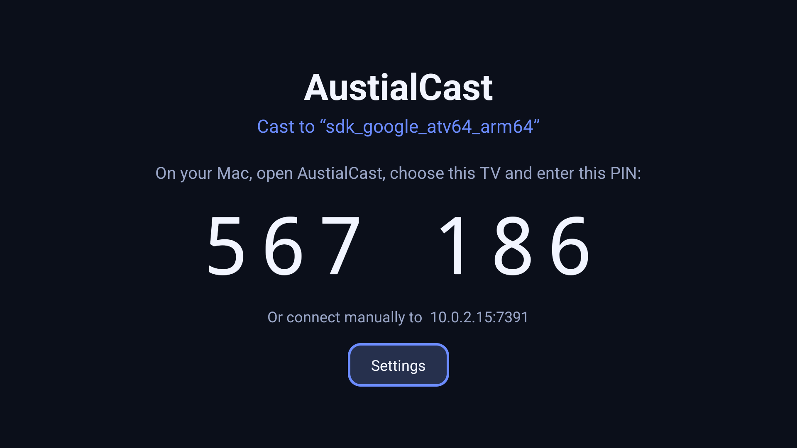
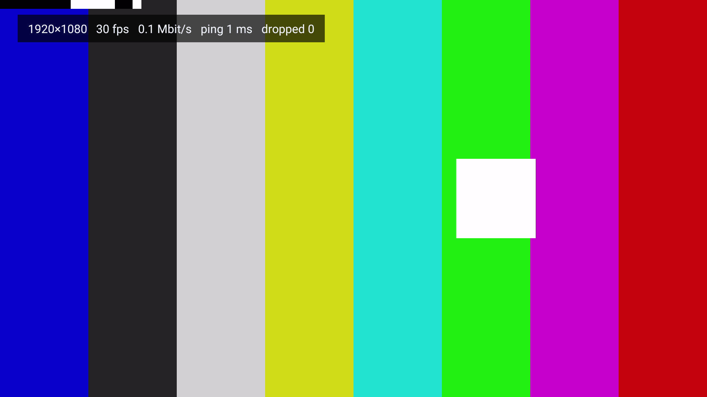
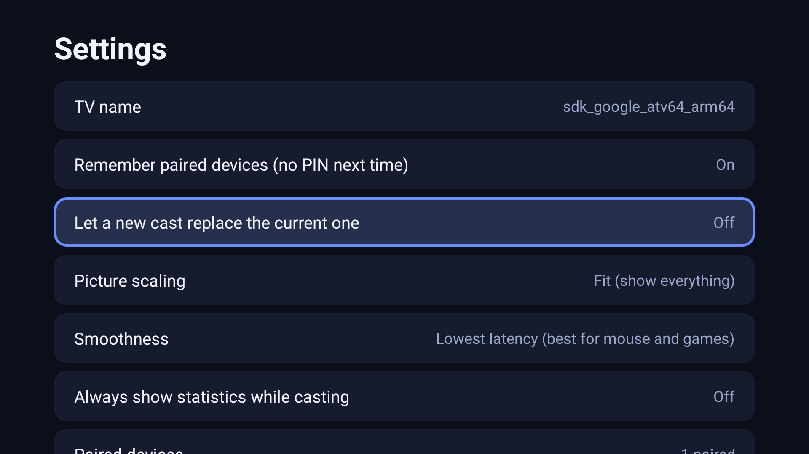
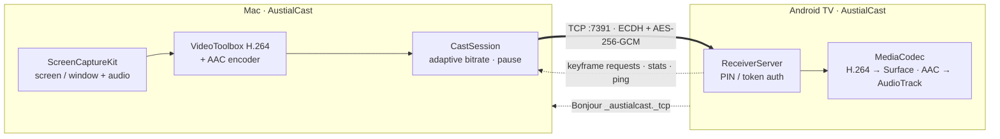
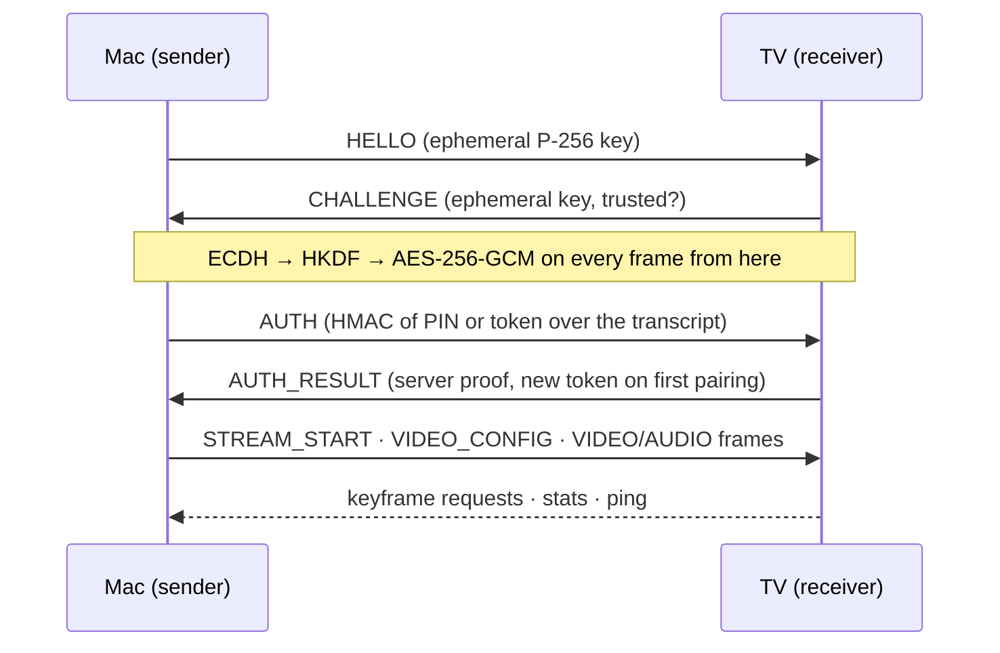

<div align="center">



# AustialCast

**Cast your MacBook to Android TV & Google TV — screen, window and system audio, encrypted, no cloud.**

[](#-install)
[](#-install)
[](#-install)
[](android)
[](mac)
[](#-testing)
[](docs/SECURITY.md)
[-informational?style=flat-square)](docs/PROTOCOL.md)
[](https://github.com/austial/AustialCast/commits/main)

[Features](#-features) · [Screenshots](#-screenshots) · [Install](#-install) · [Usage](#-usage) · [How it works](#-how-it-works) · [Security](#-security) · [Testing](#-testing) · [Troubleshooting](#-troubleshooting) · [Roadmap](#-roadmap)

</div>

---

AustialCast is a two-part app. **AustialCast for TV** runs on any Android TV / Google TV and shows a PIN;
**AustialCast for Mac** lives in your menu bar, captures your screen with hardware-accelerated H.264 and streams it
to the TV over your local network. No account, no cloud relay, no ads — your screen never leaves your LAN.

> **Status: beta.** Everything is covered by automated tests, including end-to-end casts into an Android TV emulator and
> a real ScreenCaptureKit capture. It has not yet been verified on physical TV hardware or a busy Wi-Fi network — reports welcome.

## ✨ Features

<table>
<tr>
<td width="50%" valign="top">

### 🖥️ Casting
- Mirror a **whole screen** or **a single window**
- **System audio** (AAC-LC) in sync with the picture
- Presets from **720p30 to 4K30**, auto-limited to what the TV supports, never upscaled
- Mouse pointer on / off
- **Pause / resume** from the Mac
- Static desktop? Idle frames keep the stream alive — no black screens or stalls

</td>
<td width="50%" valign="top">

### 📶 Network smart
- **Adaptive bitrate** — sheds bitrate on congestion, recovers slowly
- **Keyframe-safe frame dropping** — never smears the picture
- Latency-bounded receiver: if the TV falls behind it skips ahead instead of lagging
- **Bonjour / mDNS discovery**, or type the TV's IP
- Live ping, fps, bitrate and dropped-frame stats

</td>
</tr>
<tr>
<td width="50%" valign="top">

### 🔐 Private by design
- **ECDH P-256 → HKDF → AES-256-GCM**, per-direction keys, replay protection
- **One-time PIN** on first pairing, then PIN-less **trusted devices**
- **Mutual authentication** — the Mac verifies the TV before sending a single frame
- PINs are single-use; brute force is rate-limited and locked out
- Tokens live in the macOS Keychain

</td>
<td width="50%" valign="top">

### 📺 Made for the couch
- Big-type PIN screen, fully **remote / D-pad** navigable
- **Stats overlay** on OK / Menu / Info, press **Back twice** to stop
- **Fit / Fill** scaling and a **smoothness** (jitter-buffer) setting: 0 / 60 / 150 ms
- Let a new cast take over from the current one, manage paired devices
- Screen stays awake while casting

</td>
</tr>
</table>

Plus: launch-at-login on the Mac, a scriptable `austialcast` command-line tool, and a pure-JVM core you can embed in other receivers.

## 📸 Screenshots

<table>
<tr>
<td align="center" width="33%"><br><sub><b>Pair once</b> — PIN and address on the TV</sub></td>
<td align="center" width="33%"><br><sub><b>Cast</b> — live stream with stats overlay (test pattern)</sub></td>
<td align="center" width="33%"><br><sub><b>Tune</b> — remote-friendly settings</sub></td>
</tr>
</table>

<sub>Captured from the app running on an Android TV emulator; the stream is the built-in test pattern.</sub>

## 🚀 Install

You need: a Mac (macOS 14+) and an Android TV / Google TV (Android 7.0+) on the same network.
To build from source: Xcode 16+ (Swift 6), JDK 17 and the Android SDK (platform 36). The Gradle wrapper is included.

### 1 · TV app

```bash
./scripts/build-tv-apk.sh                    # signed APK -> dist/AustialCast-TV.apk
adb connect <tv-ip>:5555                     # enable network debugging in the TV's Developer options
adb install -r dist/AustialCast-TV.apk
```

Open **AustialCast** from the TV's app list. It shows a PIN and the TV's address.

### 2 · Mac app

```bash
./scripts/build-mac-app.sh --install         # builds and copies to /Applications/AustialCast.app
open /Applications/AustialCast.app
```

Allow **Screen Recording** (System Settings → Privacy & Security) and **Local Network** when macOS asks.

## 🎬 Usage

1. Click the TV icon in the menu bar and pick your TV.
2. First time only: type the PIN shown on the TV.
3. Choose *Entire screen* or *One window*, a quality preset, and whether to share audio — then you're casting.
4. Stop from the menu bar, or press **Back twice** on the TV remote. Press **OK** on the remote to toggle the stats overlay.

<details>
<summary><b>Command-line tool</b> (<code>austialcast</code>)</summary>

```bash
austialcast discover                                   # find TVs on the network
austialcast list                                       # displays and windows you can cast
austialcast send --host 192.168.1.20 --pin 123456      # first time (pairs this Mac)
austialcast send --host 192.168.1.20 --preset 1080p60  # afterwards: no PIN needed
austialcast send --host 192.168.1.20 --window 922 --no-audio --no-cursor
austialcast send --host 192.168.1.20 --test-pattern --seconds 10   # needs no permissions
austialcast paired                                     # list paired TVs
austialcast forget <tv-id>
```

Presets: `720p30` · `1080p30` · `1080p60` · `2160p30`. Exit codes: `10` PIN required, `11` wrong PIN, `12` TV busy, `13` locked out, `14` TV failed authentication.
The CLI is also bundled inside the app at `AustialCast.app/Contents/Resources/austialcast`.
</details>

## 🧩 How it works





| Component | Path | Tech |
|---|---|---|
| Core (protocol, crypto, receiver server, TV logic) | [`android/core`](android/core) | Kotlin/JVM — pure, unit-testable |
| TV app | [`android/app`](android/app) | Kotlin, MediaCodec, NsdManager |
| Protocol (Swift) | [`mac/Sources/AustialCastProtocol`](mac/Sources/AustialCastProtocol) | CryptoKit |
| Sender engine | [`mac/Sources/AustialCastCore`](mac/Sources/AustialCastCore) | ScreenCaptureKit, VideoToolbox, Network.framework |
| Menu bar app / CLI | [`mac/Sources/AustialCastApp`](mac/Sources/AustialCastApp) · [`austialcast`](mac/Sources/austialcast) | SwiftUI |
| Golden vectors | [`protocol-vectors`](protocol-vectors) | Generated by Kotlin, verified by Swift |

Full wire format: **[docs/PROTOCOL.md](docs/PROTOCOL.md)**.

## 🔐 Security

AustialCast is built for a home or office LAN. Frames are AES-256-GCM encrypted with keys from an ephemeral ECDH exchange
(forward secrecy), the PIN proof travels *inside* the encrypted channel, proofs are bound to the handshake transcript so a
man-in-the-middle is detected, PINs burn after every attempt, and failures are rate-limited. The honest limits — a 6-digit PIN
is not a PAKE, tokens on the TV rely on Android's app sandbox — are written down in **[docs/SECURITY.md](docs/SECURITY.md)**.

## 🧪 Testing

```bash
./scripts/test-all.sh                  # everything below
./scripts/test-all.sh --no-emulator    # skip the Android TV emulator run
```

| Layer | Count | What it proves |
|---|---|---|
| Kotlin unit + integration | 118 | framing edge cases, AES-GCM tamper / replay / reorder, RFC 4231 & 5869 vectors, H.264 SPS parsing, PIN rotation & lockout, a real `ReceiverServer` against a real client on loopback (pairing, tokens, busy, takeover, timeouts, garbage input, 600-frame streams), UI state machine |
| Swift unit + integration | 70 | **byte-exact interop with Kotlin** via golden vectors, **VideoToolbox encode → decode checking each frame's pixels**, `CastSession` vs. a fake TV (pairing, revoked tokens, **forged receiver detection**, pause/resume, keyframe requests, connection loss) |
| `scripts/e2e.sh` | 15 checks | Swift sender → Kotlin receiver: pairing, token reconnect, wrong/missing PIN, valid H.264 + AAC on disk |
| `scripts/e2e-emulator.sh` | 14 checks | Swift sender → **real TV app on an Android TV emulator**: PIN read off the screen, decoded colour bars verified from screenshot pixels, notices, no crashes |
| Android lint | enforced | `abortOnError = true` |

The emulator test needs `sdkmanager "emulator" "system-images;android-34;android-tv;arm64-v8a"`, an AVD named `austialcast_tv`
(`avdmanager create avd -n austialcast_tv -k "system-images;android-34;android-tv;arm64-v8a" -d tv_1080p`), and a
booted emulator (`emulator -avd austialcast_tv -no-window -no-audio -no-snapshot &`).

## 🛠️ Troubleshooting

| Symptom | Fix |
|---|---|
| TV isn't listed on the Mac | Both must be on the same subnet (guest / IoT VLANs often block mDNS). Use **Enter TV address manually** with the address shown on the TV, and allow *Local Network* for AustialCast. |
| "Screen Recording permission is required" | Enable AustialCast (or your terminal, for the CLI) under Privacy & Security → Screen & System Audio Recording, then relaunch. |
| Choppy video | Pick a lower preset or use 5 GHz / Ethernet. Press **OK** on the remote to see fps, bitrate, ping and drops. *Smoothness → Balanced* trades +60 ms latency for steadier motion. |
| Wrong PIN | A new PIN appears on the TV after every attempt; five failures lock that Mac out for a minute. |
| Casting stops when I leave the app on the TV | The receiver runs only while AustialCast is open on the TV. |

## 🗺️ Roadmap

- [x] Screen & window capture, system audio, adaptive bitrate, encrypted pairing
- [x] Menu bar app, CLI, Android TV app, emulator-verified end to end
- [ ] Verify on a range of physical TVs / streaming boxes
- [ ] Background receiver service and wake-on-cast
- [ ] PAKE-based first pairing (SPAKE2) to replace the PIN proof
- [ ] HEVC / 10-bit option, multiple receivers, remote control from the TV
- [ ] Windows & Linux senders (the protocol is open and small — see `docs/PROTOCOL.md`)

## 🤝 Contributing

Issues and pull requests are welcome. Please run `./scripts/test-all.sh` before opening a PR; protocol changes must
regenerate the vectors (`GENERATE_VECTORS=1 ./gradlew :core:test` in `android/`) so both implementations stay in lock-step.

## 📄 License

No license has been chosen yet; until one is added, all rights are reserved by the authors.

---

<div align="center"><sub>Built with Kotlin, Swift, ScreenCaptureKit, VideoToolbox and MediaCodec</sub></div>
